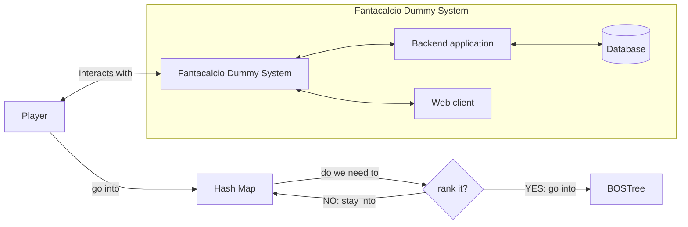

# Leaderboard system

[](https://github.com/AlessVolpe/LeaderboardSystem/actions/workflows/ci.yml)

As a part of my [Fantacalcio Dummy System](https://github.com/AlessVolpe/FantacalcioDummySystem.git) project, I wanted to experiment with type-safe and efficient data structures to implement a ranking algorithm.

The ranking happens in two different moments: when a player is added to the system, they're first placed in a hashmap; when the system needs to compile the leaderboard, players are moved to a self-balancing AVL tree.

This is the approach currently demonstrated by the CLI prototype. The reusable ranking abstraction is still under development.

## Player pool or hashmap

The player pool is implemented using a hashmap, a data structure that maps keys to values. An index is computed via a hash function \(h\), which maps the universe \(U\) of possible keys to one of the \(m\) available slots in the table:

```math
h: U \rightarrow \{0, 1, \ldots, m-1\}
```

For each key \(x\), the resulting index satisfies:

```math
0 \leq h(x) < m
```

The implementation uses open addressing with linear probing to resolve collisions, keeping the table's load factor below or equal to 0.75:

```math
\alpha = \frac{n}{m} \leq 0.75
```

where \(n\) represents the number of stored entries and \(m\) the allocated table capacity.

A well-implemented hashmap offers expected constant-time lookup, insertion and deletion, assuming a reasonable distribution of hash values. However, collisions and clustering can degrade individual operations to linear time. Insertion may also trigger a rehash, making its constant-time complexity an *amortized* expectation rather than an unconditional guarantee.

More specifically, during lookup the key is hashed and its resulting index indicates where the corresponding value should be stored. If collisions have occurred, linear probing examines subsequent slots until a matching key or an empty slot is found. Works wonders for our case of study!

The implementation also uses backward-shift deletion to preserve probe-chain continuity when entries are removed.

I find really important to say thank you to [DavidLeeds](https://github.com/DavidLeeds) for the [original implementation](https://github.com/DavidLeeds/hashmap.git). Unfortunately, I couldn't reuse his amazing work on the CMake files because it didn't fit my particular use case.

## Leaderboard or BOSTree

The leaderboard is implemented using an order-statistics tree, a variant of the binary search tree, implemented as a self-balancing AVL tree with two additional operations:

- `Select(i)`, which finds the element at the zero-based index \(i\) in sorted order;
- `Rank(x)`, which returns the zero-based position of an existing element \(x\).

Both operations have worst-case logarithmic time complexity, \(O(\log n)\), thanks to the AVL tree's height-balancing properties. The same bound applies to lookup, insertion and deletion. It's definitely pretty good, though!

To turn a regular search tree into an order-statistics tree, the nodes must also maintain information about the size of their subtrees. In this implementation, each node stores separate counts for its left and right subtrees.

Every operation that modifies the tree must preserve the invariant:

```math
\mathrm{size}(x) =
\mathrm{size}(\mathrm{left}(x)) +
\mathrm{size}(\mathrm{right}(x)) + 1
```

where:

```math
\mathrm{size}(\mathrm{NULL}) = 0
```

by definition.

These counts allow the tree to navigate directly towards a selected rank without traversing every preceding node. AVL rotations must therefore preserve not only the binary-search ordering and balance factors, but also parent relationships and subtree cardinalities.

The tree uses map semantics, meaning that keys and values are represented by separate pointers. Its comparison function determines the ordering; the eventual score-based ranking rules and tie-breaking policies belong to the higher-level ranking abstraction.

Again, it's really important to thank [phillipberndt](https://github.com/phillipberndt) for the [original implementation](https://github.com/phillipberndt/bostree.git), including the testing performed with AFL and Valgrind.

## Player id generation

### A PRNG better than rand()

One of the challenges to overcome was generating identifiers for the players. And, as most of us know, C's `rand()` function isn't exactly cut for greatness.

```c
srand(time(NULL));
rand(); // sorry little man
```

While looking into alternative pseudo-random number generators, I came across a Stack Overflow discussion about generating random numbers for fractal flames. The requirements were quite reasonable:

- It should produce relatively high-quality streams of random numbers;
- Its period should be greater than ten billion;
- It should be fast enough to offer a good performance trade-off.

The answer suggested the Mersenne Twister, a PRNG developed by Makoto Matsumoto and Takuji Nishimura. The widely used MT19937 variant generates 32-bit values and has an exceptionally long period:

```math
2^{19937} - 1
```

The algorithm was designed to improve the statistical properties of earlier pseudo-random number generators. However, it remains deterministic: the same initial state produces the same sequence, and its statistical properties do not make it cryptographically secure.

I have to thank [ESultanik](https://github.com/ESultanik) for the first adaptation of the pseudocode described in:

M. Matsumoto and T. Nishimura, "Mersenne Twister: A 623-dimensionally equidistributed uniform pseudo-random number generator," *ACM Transactions on Modeling and Computer Simulation*, Vol. 8, No. 1, pp. 3–30, 1998.

I also took the time to address Issue #3 in that implementation and use explicitly sized integer types, mainly `uint32_t` instead of `unsigned long` and `int32_t` instead of `int`, both provided by `<stdint.h>`.

### GUID generation

After tackling the randomized part of the identifier generation, I had to find a simple, not particularly elegant, yet effective solution. Stack Overflow was a saving grace once again.

The current implementation generates UUIDv4-shaped identifiers using the Mersenne Twister and a locally managed seed. I slightly improved the original approach to avoid identical initial states within the same clock tick and to handle the allocated resources correctly.

There is, however, an important distinction between producing a random-looking identifier and guaranteeing its uniqueness.

The current implementation is sufficient for experimenting with the CLI prototype, but it doesn't provide cryptographic randomness or a formal guarantee against identifier collisions. A production implementation should use a trusted UUID library or a cryptographically secure random source.

## A really simple drawing

The following diagram represents the intended architecture of the Fantacalcio Dummy System. Not all components are implemented in the current native library.



## Development: 3.x native engine foundation

The 3.x development line turns the original executable experiment into a reusable native library. The current CLI is retained as an example consumer while the data structures are stabilized and tested before Fantacalcio-specific domain logic is introduced.

Configure and build a debug version:

```bash
cmake -S . -B build -DCMAKE_BUILD_TYPE=Debug
cmake --build build
```

Run the test suite:

```bash
ctest --test-dir build --output-on-failure
```

AddressSanitizer and UndefinedBehaviorSanitizer can be enabled on supported GCC/Clang builds:

```bash
cmake -S . -B build \
  -DCMAKE_BUILD_TYPE=Debug \
  -DLEADERBOARD_ENABLE_SANITIZERS=ON
cmake --build build
ctest --test-dir build --output-on-failure
```

Compiler warnings can also be treated as errors by enabling `LEADERBOARD_WARNINGS_AS_ERRORS`.

The library target is `leaderboard` (`Leaderboard::leaderboard` inside CMake). The executable prototype is built as `leaderboard_cli` and intentionally kept separate from the library.

Correctness is evaluated using deterministic regression tests, structural invariants and randomized workloads with fixed seeds. These tests establish evidence about functional behavior, but should not be confused with a performance evaluation. Future benchmarking will require controlled workloads, recorded hardware and compiler configurations, repeated measurements, and comparisons against independent implementations.

### 3.0.1: Build & test foundation

An initial CTest suite provides smoke tests for the hashmap and BOSTree implementations, while GitHub Actions runs builds on Linux/GCC and Windows/MSYS2 UCRT64. Repository tracking rules and development documentation have also been standardized to improve reproducibility and maintainability.

This milestone establishes the development and testing infrastructure without modifying the underlying data structure algorithms.

### 3.0.2: Hashmap stabilization

The native hashmap retains open addressing, linear probing and backward-shift removal. Its ownership and error contracts, invariants, and validation methods are specified in [docs/hashmap-contract.md](docs/hashmap-contract.md).

Run `ctest --test-dir build --output-on-failure` after building to execute smoke, regression, and typed-macro tests. BOSTree stabilization is addressed separately.

### 3.0.3: BOSTree stabilization

The AVL-based order-statistics tree has been stabilized by correcting tree rotations, parent-child relationships, subtree metadata, and rank/select operations. Duplicate-key handling and insertion safety have also been improved to preserve structural consistency.

Deterministic regression tests verify AVL balancing, subtree sizes, traversal order, and order-statistics invariants across sequential and randomized insertions. The implementation contracts and validation methodology are documented in [docs/bostree-contract.md](docs/bostree-contract.md).

Node deletion and post-deletion rebalancing were subsequently addressed in milestone 3.0.4.

### 3.0.4: BOSTree deletion and lifecycle management

Node deletion now maintains AVL balancing, parent links, subtree counts and zero-based order statistics, including the two-child successor-transplant case.

Retained node references that become invalid after removal or tree destruction; payload finalization occurs exactly once, and retained tombstones can be released independently of the tree's lifetime.

The `bostree_deletion` regression suite covers exhaustive deletion orders, randomized insert/remove operations and reference lifecycle cases. The API contracts, verification strategy and limitations are documented in [docs/bostree-deletion-contract.md](docs/bostree-deletion-contract.md).

The legacy CLI also receives a compiler-warning and ownership cleanup: typed player pointers replace integer-to-pointer casts, names and generated IDs have explicit lifetimes, and CTest exercises normal and invalid input.

The PRNG and UUID utilities receive targeted correctness and resource-handling fixes. CI now treats compiler warnings as errors.

### 3.0.5: Ranking abstraction

The native library now exposes an opaque, domain-neutral ranking API built on
the hashmap and BOSTree. Participants have unique string identifiers and
signed integer scores; rankings are ordered by descending score with a
stable, deterministic identifier tie-breaker. Scores can be updated without
rebuilding the entire ranking, while rank lookup and selection remain
logarithmic in the number of participants.

Fixed-seed regression and differential tests compare updates, deletions,
ordering and rank queries against an independently sorted reference model.
The API, failure and ownership contracts, complexity bounds and limitations
are described in [docs/ranking-contract.md](docs/ranking-contract.md).
The existing example CLI remains unchanged; Fantacalcio-specific scoring and
simulation logic are deferred to later milestones.

### 3.0.6: Module boundaries and BOSTree API encapsulation

The build now compiles containers, ranking and legacy utilities as separate
internal CMake object targets, then combines them into the existing
`Leaderboard::leaderboard` static library. This preserves the established
consumer target without suggesting that each component is already installed
or independently linkable.

BOSTree now exposes opaque `bostree_t` and `bostree_node_t` handles, with
borrowed key/data and validity accessors. Older `BOSTree` and `BOSNode`
typedefs remain available, but directly accessing node or tree fields is no
longer part of the public API. Structural regression tests explicitly include
the private representation; normal consumers do not. The ownership and
finalization rules from 3.0.4 remain unchanged.

Hashmap now exposes an opaque `hashmap_base_t` handle, with storage,
probing metadata, and iterators' entry layouts hidden in a private header.
The typed `HASHMAP` macros are retained, but `hashmap_init` now returns a
status and the macro wrapper owns a heap-allocated base handle. Low-level
consumers that previously embedded the complete hashmap base must migrate to
`hashmap_base_new`/`hashmap_base_destroy` and public accessors. Dedicated
white-box tests retain access to the private representation.

The compatibility boundaries, dependency layout and remaining portability work
are described in [docs/api-encapsulation-contract.md](docs/api-encapsulation-contract.md).

## License and third-party notices

This project is distributed under the [GNU General Public License, version 3](LICENSE).
The hashmap, BOSTree, and MTwister implementations build on existing work;
their original authors, license notices, and the complete MIT license are
recorded in [THIRD_PARTY_NOTICES.md](THIRD_PARTY_NOTICES.md). My modifications
are tracked in the repository history. The upstream license grants remain
intact.
