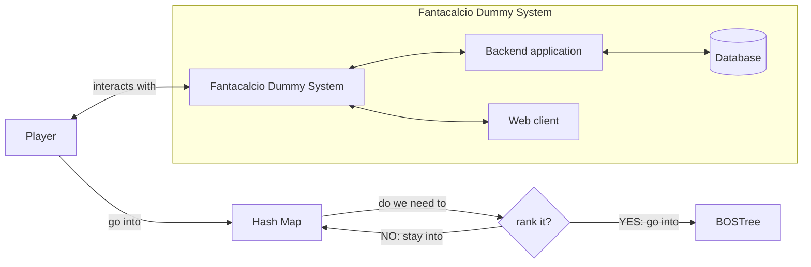

# Leaderboard system

[](https://github.com/AlessVolpe/LeaderboardSystem/actions/workflows/ci.yml)
[](https://github.com/AlessVolpe/LeaderboardSystem/actions/workflows/ci.yml)
[](https://github.com/AlessVolpe/LeaderboardSystem/actions/workflows/ci.yml)

As a part of my [Fantacalcio Dummy System](https://github.com/AlessVolpe/FantacalcioDummySystem.git)
project, I wanted to experiment with type-safe and efficient data structures
to implement a ranking algorithm.

The ranking happens in two different moments, when a player is added to the
system is at first put into a hashmap, then when the system needs to compile
the leaderboard every player is moved to a self-balancing AVL tree.

## Player pool or hashmap

The player pool is implemented using a hashmap, a data structure that maps
key to value. An index is computed via a hash function h, generically it maps
the universe U of keys

```math
h: U ⇒ {0, ..., m-1}
```

to array indices or slots within
the table for each

```math
h(x) ∈ 0, ..., m-1\text{ for }x ∈ S ∧ m<n
```

A well implemented hash map offers constant (linear at worst) time complexity
for insertion, lookup and deletion; while space complexity is linear. More
specifically, during lookup the key is hashed and the resulting hash indicates
where the corresponding value is stored: works wonders for our case of study!

I find really important to say thank you for the
[original implementation](https://github.com/DavidLeeds/hashmap.git) to
[DavidLeeds](https://github.com/DavidLeeds), from his repo I couldn't take his
amazing work on the CMake files because it didn't fit my use case.

## Leaderboard or BOSTree

The leaderboard is implemented using an order statistic tree,
a variant of the binary search tree, implemented as self-balancing AVL tree
with two additional methods:

- Select(i), which finds i'th smallest element;
- Rank(x), which returns the rank of a given element.

Both of those two methods run in a logarithmic time complexity, which is indeed
the worst case scenario considering it happens when implemented as a
self-balancing tree; it's definitely pretty good though!

To turn a regular search tree into an order statistic tree, the nodes need to
store one additional value for the size of the subtree rooted at that node.
All operation that modify the tree must adjust this information to preserve the
invariant that

```math
size[x] = size[left[x]] + size[right[x]] + 1
```

where ```size[NULL] = 0```, by definition.
The tree is implemented using map semantics, that is, there are separate key
and value pointers.

Again it's really important to me to thank also
[phillipberndt](https://github.com/phillipberndt) for the
[original implementation](https://github.com/phillipberndt/bostree.git) and
testing both on AFL and Valgrind.

## Player id generation

### A PRNG better than rand()

One of the challenges to overcome, it was having unique ids for the players, and as most of us know c's ```rand()``` function isn't really cut for greatness.

```c++
srand(time(NULL))
rand() // sorry little man
```

On Stack Overflow some guy, 7 years ago, decided to ask about PRNGs for his fractal
flame generator, with the sequent requirements:

- It should produce relatively high quality streams of random numbers
- Its period should be over ten billion
- It should be fast enough and offer a good performance trade-off.

The best answer suggested the Mersenne Twister, a PRNG developed by Makoto Matsumoto
and Takuji Nishimura in 1997. Generally faster than many older PRNGs, like ```rand()```
(rip), it was designed specifically to rectify flaws found in those PRNGs.
The most common version of the algorithm is based on the Mersenne prime ```(2^19937)-1```
(yikes!), and its standard implementation MT19937 uses a 32-bt word length.

I have to thank [ESultankik](https://github.com/ESultanik) for the first adaptation of the
pseudocode in: M. Matsumoto and T. Nishimura, "Mersenne Twister: A 623-dimensionally
equidistributed uniform pseudorandom number generator," ACM transactions on Modeling and
Computer Simulation Vol. 8, No. 1, January pp.3-30 1998. I took the time to fix the Issue #3
in his code and changed the types to accurately sized ones, mainly ```unsigned long``` to
```uint32_t``` and secondly ```int``` to ```int32_t``` both found in ```stdint.h```.

### GUID generation

After tackling the randomized part of the GUID generation I had to search for a simple, really
not elegant, yet effective solution. Stack Overflow is a saving grace. I slightly improved the
original implementation that was posted over 10 years ago (and yet I was already coding...)
giving it a slight (really slight) elegance, but it works it's all I need.

## A really simple drawing



## Development: 3.x native engine foundation

The 3.x development line turns the original executable experiment into a reusable native
library. The current CLI is retained as an example consumer while the data structures are
stabilized and tested before Fantacalcio-specific domain logic is introduced.

Configure and build a debug version:

```bash
cmake -S . -B build -DCMAKE_BUILD_TYPE=Debug
cmake --build build
```

Run the test suite:

```bash
ctest --test-dir build --output-on-failure
```

AddressSanitizer and UndefinedBehaviorSanitizer can be enabled on GCC/Clang builds:

```bash
cmake -S . -B build \
  -DCMAKE_BUILD_TYPE=Debug \
  -DLEADERBOARD_ENABLE_SANITIZERS=ON
cmake --build build
ctest --test-dir build --output-on-failure
```

The library target is `leaderboard` (`Leaderboard::leaderboard` inside CMake). The executable
prototype is now built as `leaderboard_cli` and is intentionally kept separate from the library.

### 3.0.1: Native engine foundation

An initial CTest suite provides smoke tests for the hashmap and BOSTree implementations, while GitHub Actions validates 
builds on Linux/GCC and Windows/MSYS2 UCRT64. Repository tracking rules and development documentation have also been 
standardized to improve reproducibility and maintainability. This milestone establishes the development and testing 
infrastructure without modifying the underlying data structure algorithms.

### 3.0.2: Hashmap stabilization

The native hashmap retains open addressing, linear probing and backward-shift
removal. Its ownership and error contracts, invariants, and validation methods
are specified in [docs/hashmap-contract.md](docs/hashmap-contract.md).
Run `ctest --test-dir build --output-on-failure` after building to execute
smoke, regression, and typed-macro tests. BOSTree stabilization is separate.

### 3.0.3: BOSTree stabilization

The AVL-based order-statistics tree has been stabilized by correcting tree rotations, parent-child relationships, 
subtree metadata, and rank/select operations. Duplicate-key handling and insertion safety have also been improved to 
preserve structural consistency.

Deterministic regression tests verify AVL balancing, subtree sizes, traversal order, and order-statistics invariants 
across sequential and randomized insertions. The implementation contracts and validation methodology are documented in 
[docs/bostree-contract.md](docs/bostree-contract.md). Node deletion and post-deletion rebalancing are deferred to 
milestone 3.0.4.
